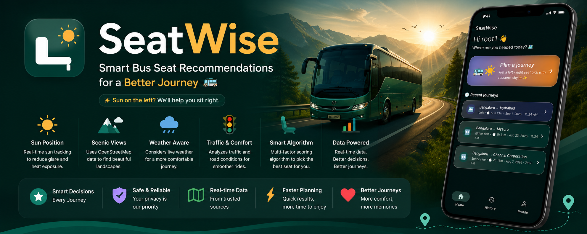
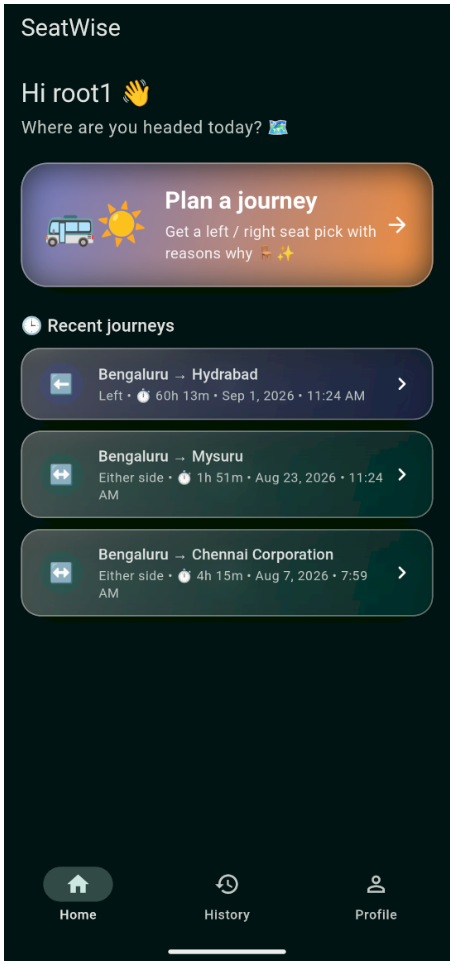
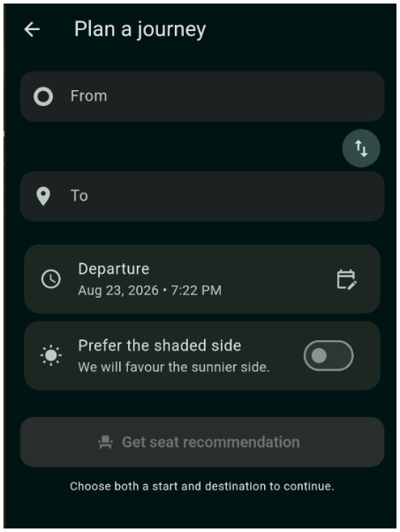
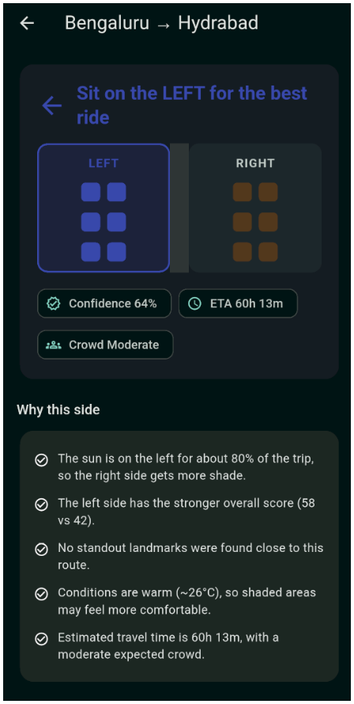
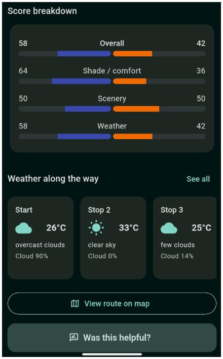

<p align="center">
  
</p>

<h1 align="center">SeatWise 🚌☀️</h1>

<p align="center">
  <b>Which side should you sit on? SeatWise tells you — and why.</b><br/>
  Sun & shade prediction, scenic views, weather, and crowd level, blended into one confident LEFT / RIGHT pick. 🪑✨
</p>

<p align="center">
  
  
  
  
  
  
</p>

<p align="center">
  <a href="#-features">Features</a> •
  <a href="#-screenshots">Screenshots</a> •
  <a href="#-how-it-works">How it works</a> •
  <a href="#-getting-started">Getting started</a> •
  <a href="#-project-structure">Project structure</a> •
  <a href="#-testing">Testing</a> •
  <a href="#-credits">Credits</a>
</p>

---

## 📖 About

**SeatWise** recommends whether you should sit on the **LEFT** or **RIGHT** side of a vehicle (buses first) for your specific trip — based on:

- ☀️ **Sun & shade prediction** along your route and departure time
- 🏞️ **Scenic views** and nearby highly-rated attractions
- 🌦️ **Weather** at each point along the journey
- 👥 An estimated **crowd level** and **ETA**
- 💬 A clear, plain-English **explanation of why**

It's a production-oriented **Flutter + Firebase** app with clean architecture, Riverpod state management, and a deterministic recommendation engine that runs both **on-device** (offline-aware) and **in the cloud** (Firebase Cloud Functions). Everything runs on **free APIs only** — OpenRouteService, OpenWeather, OpenStreetMap (Nominatim + Overpass), and a local SunCalc port.

---
## 🎬 SeatWise — Project Showcase

<p align="center">
  <a href="https://github.com/user-attachments/assets/790b9370-3923-44f1-a2dc-4d8833a7eb3d">
    
  </a>
</p>

<p align="center">
  **▶ Click the preview to watch SeatWise in action**
</p>

## ✨ Features

| | |
|---|---|
| 🧭 **Smart seat recommendation** | Deterministic scoring engine blends comfort (shade), scenery, and weather into one LEFT / RIGHT / either call |
| 🗺️ **Route-aware** | Real driving routes via OpenRouteService, sampled into segments with sun position computed for each |
| 🌤️ **Live weather timeline** | See conditions change along your route, not just at the start |
| 🏞️ **Scenic highlights** | Nearby attractions pulled from OpenStreetMap, grouped by side of travel |
| 🕒 **Journey history** | Every trip is saved automatically — revisit past recommendations any time |
| 🔐 **Firebase Auth** | Email/password sign-up, sign-in, and password reset |
| 🌗 **Light & dark mode** | Full Material 3 theming from a single seed colour |
| 🧊 **Liquid-glass, 3D-interactive UI** | Frosted glass cards (`GlassContainer`) and drag-to-tilt 3D cards with a moving light sheen (`TiltCard`) |
| 🎬 **Animated splash screen** | A branded, animated launch experience, with native splash config included |
| 🎨 **Custom app icon** | Seat + sun mark, generated for both Android (adaptive icon) and iOS |
| 😄 **Emoji-forward UI** | Friendly, expressive copy throughout — this app doesn't take itself too seriously |

---

## 📱 Screenshots

> These are **concept UI previews**, mocked up to match the app's actual widget tree and colour system (`lib/config/theme.dart`, `GlassContainer`, `TiltCard`) — not live device captures. Swap in real screenshots after your first `flutter run`; see [Updating the screenshots](#-updating-the-screenshots-with-real-captures) below.

<p align="center">
  
  
  &nbsp;&nbsp;
  
  
</p>

---

## 🧠 How it works

For a given origin, destination and departure time, the engine:

1. Fetches a driving route from **OpenRouteService** (full polyline + ETA).
2. Samples the polyline into ~2 km **segments**, each with a travel heading and an estimated clock time.
3. Computes the **sun position** for each segment (a dependency-free SunCalc port) and decides which side of the vehicle the sun falls on — weighted by angle, intensity, and sky **clearness** from **OpenWeather**.
4. Finds scenic **attractions** near the route with **OpenStreetMap Overpass** and assigns each to the left or right of travel.
5. Blends three 0–100 sub-scores per side — **comfort** (shade), **scenery**, and **weather** — into a final score, picks the better side (or "either" when close), and writes a plain-English explanation.

The exact same algorithm is implemented twice — in Dart (`lib/engine/`) and TypeScript (`functions/src/engines/`) — so the app can call the Cloud Function or fall back to the on-device engine transparently.

```
UI (screens/widgets)
      │  watches
Providers / Controllers (Riverpod)
      │  call
Repositories  ── translate errors into typed Failures, return Result<T>
      │  use
Services (HTTP clients)      Engine (pure, deterministic)
      │                          │
Free APIs (ORS/OpenWeather/OSM)  SunCalc + scoring
```

---

## 🚀 Getting started

### Prerequisites

- [Flutter SDK](https://docs.flutter.dev/get-started/install) 3.27+ (`flutter doctor` should be green)
- Android Studio (SDK + an emulator, or a physical device) / Xcode for iOS
- [Firebase CLI](https://firebase.google.com/docs/cli): `npm install -g firebase-tools`
- [FlutterFire CLI](https://firebase.google.com/docs/flutter/setup): `dart pub global activate flutterfire_cli`

### 1. Clone & configure Firebase

```bash
git clone https://github.com/vignesh3899/SeatWise.git
cd SeatWise
flutterfire configure
```

### 2. Firestore & Auth

```bash
firebase deploy --only firestore:rules,firestore:indexes
```

Then enable **Email/Password** sign-in under **Build → Authentication** in the Firebase console.

### 3. Environment variables

```bash
cp .env.example .env
# then fill in OPEN_ROUTE_API_KEY, OPEN_WEATHER_API_KEY, etc.
```

### 4. Install & run

```bash
flutter pub get
flutter run
```

### 5. Generate the app icon & native splash screen

```bash
dart run flutter_launcher_icons
dart run flutter_native_splash:create
```

> Full step-by-step setup (with more detail on Cloud Functions, emulators, and troubleshooting) lives in `docs/`.

---

## 🗂️ Project structure

```
seatwise/
├── lib/
│   ├── config/        env, theme
│   ├── core/          Result, Failure, exceptions, constants, geo math
│   ├── models/         immutable domain models (+ JSON)
│   ├── services/       OpenRouteService, OpenWeather, Nominatim, Overpass, …
│   ├── repositories/   auth, journeys, feedback, places, recommendation
│   ├── engine/          SunCalculator, RouteSampler, SeatEngine (scoring)
│   ├── providers/       Riverpod providers & controllers
│   ├── screens/          auth, home, planner, recommendation, weather, scenic, map, history, feedback, profile, splash
│   ├── widgets/          reusable UI — seat card, score bars, GlassContainer, TiltCard, …
│   ├── app.dart         MaterialApp + splash + auth gate
│   └── main.dart        bootstrap (Firebase, Crashlytics, dotenv)
├── functions/          Cloud Functions (TypeScript) — server-side engine
├── assets/
│   ├── icon/            app icon source (adaptive icon + foreground)
│   └── splash/          splash logo
├── test/                unit + widget tests
├── integration_test/    primary journey flow
└── docs/                setup & deployment guides, README images
```

---

## 🧪 Testing

```bash
flutter test                                   # unit + widget tests
flutter test integration_test/app_test.dart    # primary journey flow
cd functions && npm run build                  # type-checks the cloud engine
```

---

## 🌐 Free API notes & limits

| API | Used for | Notes |
|---|---|---|
| [OpenRouteService](https://openrouteservice.org/) | Directions | Free key, generous daily quota |
| [OpenWeather](https://openweathermap.org/) | Weather along route | Free "current weather" tier |
| [Nominatim](https://nominatim.org/) (OSM) | Geocoding | Max ~1 req/sec, descriptive User-Agent required |
| [Overpass](https://overpass-api.de/) (OSM) | Points of interest | Shared public instance — be gentle |
| SunCalc | Sun position | Local, dependency-free, no key needed |

---

## 🖼️ Updating the screenshots with real captures

Once you have the app running on a device/emulator:

1. Take screenshots of the Home and Recommendation screens (⌘+S / device screenshot shortcut).
2. Drop them into `docs/images/`, e.g. `docs/images/screenshot_home.png`.
3. Swap the `` `src` paths in the **Screenshots** section of this README to point at your new files.
4. Commit and push — GitHub renders README images straight from the repo, no external hosting needed.

---

## 🤝 Contributing

Issues and pull requests are welcome! If you're adding a feature, please:

1. Fork the repo and create a branch: `git checkout -b feature/my-feature`
2. Keep the architecture boundaries intact (UI → providers → repositories → services/engine)
3. Add/update tests where it makes sense
4. Open a PR with a clear description of the change

---

## 📄 License

Distributed under the MIT License. See `LICENSE` for details.

---

## 🙌 Credits

- Built by [**vignesh3899**](https://github.com/vignesh3899)
- App icon, splash screen, liquid-glass/3D UI components, banner, and this README were designed and implemented with **[Claude](https://claude.com)** (Anthropic) 🤖
- Map data © [OpenStreetMap](https://www.openstreetmap.org/copyright) contributors • Routing by [OpenRouteService](https://openrouteservice.org/) • Weather by [OpenWeather](https://openweathermap.org/)

<p align="center">Made with 💚 in Flutter + Firebase</p>
